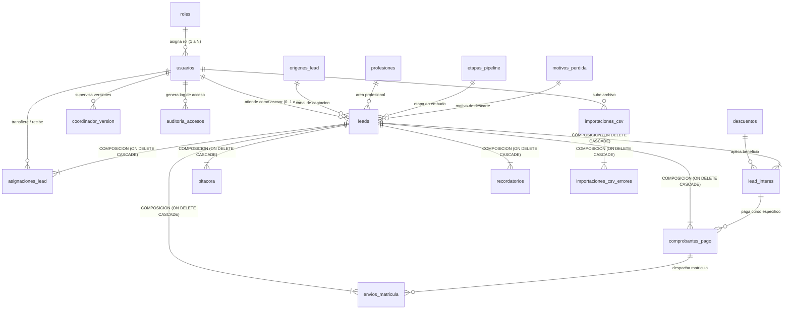

# 🗄️ DISEÑO DE BASE DE DATOS OFICIAL E INMUTABLE (2DO PARCIAL)
## CRM Educativo UNEXO | INF513 - Tecnología Web | Grupo 05 SC
**Docente:** Msc. Ing. Evans Balcázar Veizaga  
**Asesora de Negocio:** Ing. Miriam  
**Responsable de Arquitectura de Datos:** Nataly Vanessa Martínez (Líder)  
**Documentación y Diagramas:** Jael Sandoval & Nicol Herbas

---

## 🎯 OBJETIVO DE ESTE DOCUMENTO

Este documento representa la **versión definitiva, inmutable y oficial de la Base de Datos PostgreSQL** para el 2do Parcial. 
- Contiene las **19 tablas del sistema** (las 17 tablas del negocio validadas en el 1P + 2 tablas técnicas exigidas por la rúbrica oficial del Ing. Evans Balcázar).
- Ningún integrante debe alterar nombres de tablas ni de columnas para no romper los modelos de Eloquent ni los diagramas UML.
- Incluye el **Diccionario de Relaciones UML** para que Jael grafique el Diagrama de Clases y el MER en Enterprise Architect sin observaciones docentes.

---

## 🚀 COMANDO OFICIAL PARA RECONSTRUIR LA BASE DE DATOS

Para reconstruir la base de datos limpia con todas sus tablas, restricciones y datos de prueba:

```bash
cd /home/nataly/Projects/crm-educativo/crm

# Recrear tablas desde cero y cargar datos iniciales
php artisan migrate:fresh --seed
```

*(En producción en Tecnoweb, este mismo proceso se dispara automáticamente a través de `deploy_runner.php`).*

---

## 📊 RESUMEN ESTRUCTURAL (19 TABLAS)



---

## 📐 DICCIONARIO DE RELACIONES UML (GUÍA PARA ENTERPRISE ARCHITECT)

> ⚠️ **REGLA DE ORO DE EVANS BALCÁZAR EN DIAGRAMAS DE CLASES:**  
> **EL ROMBO SIEMPRE VA PEGADO AL CONTENEDOR / PADRE / TODO.**  
> **NUNCA en el hijo.** Si colocas el rombo en el hijo, estás diciendo que el hijo contiene al padre y el docente reprobará el diagrama.

| Entidad Padre (Contenedor) | Entidad Hija (Dependiente) | Tipo de Relación UML | Símbolo en EA | Lado del Rombo | Justificación en Base de Datos |
| :--- | :--- | :---: | :---: | :---: | :--- |
| **`Lead`** | **`LeadInteres`** | **Composición** | Rombo Negro `◆` | Pegado a **`Lead`** | `ON DELETE CASCADE`. Si el lead se borra, sus intereses desaparecen. |
| **`Lead`** | **`ComprobantePago`** | **Composición** | Rombo Negro `◆` | Pegado a **`Lead`** | `ON DELETE CASCADE`. Un voucher bancario no puede existir huérfano. |
| **`Lead`** | **`AsignacionLead`** | **Composición** | Rombo Negro `◆` | Pegado a **`Lead`** | `ON DELETE CASCADE`. El historial de transferencias pertenece al lead. |
| **`Lead`** | **`Bitacora`** | **Composición** | Rombo Negro `◆` | Pegado a **`Lead`** | `ON DELETE CASCADE`. Las notas comerciales mueren con el prospecto. |
| **`Lead`** | **`Recordatorio`** | **Composición** | Rombo Negro `◆` | Pegado a **`Lead`** | `ON DELETE CASCADE`. Tareas comerciales atadas al lead. |
| **`Lead`** | **`EnvioMatricula`** | **Composición** | Rombo Negro `◆` | Pegado a **`Lead`** | `ON DELETE CASCADE`. Registro de envío a Proyecto 2. |
| **`ImportacionCsv`** | **`ImportacionCsvError`**| **Composición** | Rombo Negro `◆` | Pegado a **`ImportacionCsv`** | `ON DELETE CASCADE`. Las filas fallidas pertenecen al archivo CSV subido. |
| **`Usuario`** | **`Lead`** | **Asociación** | Línea simple `───` | Sin rombo | Un asesor comercial existe independientemente de si tiene o no prospectos. |
| **`Rol`** | **`Usuario`** | **Asociación** | Línea simple `───` | Sin rombo | Catálogo de roles independiente. |
| **`OrigenLead`** | **`Lead`** | **Asociación** | Línea simple `───` | Sin rombo | Catálogo de canales de marketing independiente. |
| **`Profesion`** | **`Lead`** | **Asociación** | Línea simple `───` | Sin rombo | Catálogo de profesiones independiente. |
| **`EtapaPipeline`** | **`Lead`** | **Asociación** | Línea simple `───` | Sin rombo | Catálogo de etapas independiente. |
| **`MotivoPerdida`** | **`Lead`** | **Asociación** | Línea simple `───` | Sin rombo | Catálogo de causales de descarte independiente. |
| **`Descuento`** | **`LeadInteres`** | **Asociación** | Línea simple `───` | Sin rombo | Catálogo de promociones comerciales independiente. |
| **`LeadInteres`** | **`ComprobantePago`** | **Asociación** | Línea simple `───` | Sin rombo | El comprobante apunta opcionalmente al interés que está pagando. |

```text
DIAGRAMA DE COMPOSICIÓN CORRECTO EN UML:
+------------+                                +-------------------+
|    Lead    | ◆ 1 --------------------- 0..* |    LeadInteres    |
+------------+   (Rombo NEGRO en Lead)        +-------------------+

DIAGRAMA INCORRECTO (AL REVÉS - OBSERVADO POR EVANS):
+------------+                                +-------------------+
|    Lead    | 1 --------------------- 0..* ◆ |    LeadInteres    |  <--- ERROR GRAVE
+------------+                                +-------------------+
```

---

## 📋 ESPECIFICACIÓN FÍSICA TABLA POR TABLA

---

### CATEGORÍA 1: TABLAS CATÁLOGO / LOOKUPS (PARAMÉTRICAS)

#### 1. `roles` (Catálogo de Perfiles RBAC)
*Propósito:* Define los roles de seguridad de la plataforma.
- `id_rol` (BIGSERIAL PRIMARY KEY)
- `nombre` (VARCHAR(30) NOT NULL UNIQUE: `Administrador`, `Coordinador`, `Vendedor`)
- `descripcion` (VARCHAR(150) NULL)
- `created_at` (TIMESTAMP NULL)
- `updated_at` (TIMESTAMP NULL)

#### 2. `etapas_pipeline` (Catálogo de Fases del Embudo)
*Propósito:* Los 6 estados oficiales del ciclo comercial.
- `id_etapa` (BIGSERIAL PRIMARY KEY)
- `nombre` (VARCHAR(30) NOT NULL: `Nuevo`, `En Contacto`, `En Seguimiento`, `Promesa de Pago`, `Matriculado`, `Perdido`)
- `orden` (INT NOT NULL UNIQUE)
- `created_at` (TIMESTAMP NULL)
- `updated_at` (TIMESTAMP NULL)

#### 3. `origenes_lead` (Canales de Captación)
*Propósito:* Canales de marketing de donde provienen los prospectos.
- `id_origen` (BIGSERIAL PRIMARY KEY)
- `nombre` (VARCHAR(50) NOT NULL UNIQUE: `Facebook`, `TikTok`, `Instagram`, `Web`, `Feria`, `WhatsApp`, `Referido`)
- `created_at` (TIMESTAMP NULL)
- `updated_at` (TIMESTAMP NULL)

#### 4. `profesiones` (Catálogo Académico del Prospecto)
*Propósito:* Área de formación previa para perfilado de postgrados.
- `id_profesion` (BIGSERIAL PRIMARY KEY)
- `nombre` (VARCHAR(100) NOT NULL UNIQUE)
- `created_at` (TIMESTAMP NULL)
- `updated_at` (TIMESTAMP NULL)

#### 5. `motivos_perdida` (Catálogo de Causales de Descarte)
*Propósito:* Motivos normalizados por los cuales se descarta un prospecto en etapa 6.
- `id_motivo` (BIGSERIAL PRIMARY KEY)
- `nombre` (VARCHAR(80) NOT NULL UNIQUE: `Precio elevado`, `Falta de tiempo`, `Ya no interesado`, `Eligio otra institucion`, etc.)
- `activo` (BOOLEAN DEFAULT TRUE)
- `created_at` (TIMESTAMP NULL)
- `updated_at` (TIMESTAMP NULL)

#### 6. `descuentos` (Beneficios y Promociones Comerciales)
*Propósito:* Descuentos aplicables por convenio, pronto pago o fidelidad de ex-alumno.
- `id_descuento` (BIGSERIAL PRIMARY KEY)
- `nombre` (VARCHAR(100) NOT NULL)
- `tipo` (VARCHAR(20) DEFAULT 'PORCENTAJE': `PORCENTAJE`, `MONTO_FIJO`)
- `porcentaje` (NUMERIC(5,2) NULL)
- `monto_fijo` (NUMERIC(10,2) NULL)
- `descripcion` (TEXT NULL)
- `activo` (BOOLEAN DEFAULT TRUE)
- `created_at` (TIMESTAMP NULL)
- `updated_at` (TIMESTAMP NULL)

---

### CATEGORÍA 2: ENTIDADES PRINCIPALES

#### 7. `usuarios` (Operadores del CRM)
*Propósito:* Usuarios con acceso al sistema, autenticados por `password_hash`.
- `id_usuario` (BIGSERIAL PRIMARY KEY)
- `id_rol` (BIGINT NOT NULL REFERENCES roles(id_rol))
- `nombre_completo` (VARCHAR(120) NOT NULL)
- `correo` (VARCHAR(100) NOT NULL UNIQUE)
- `password_hash` (VARCHAR(255) NOT NULL)
- `activo` (BOOLEAN DEFAULT TRUE)
- `participa_round_robin` (BOOLEAN DEFAULT FALSE)
- `created_at` (TIMESTAMP NULL)
- `updated_at` (TIMESTAMP NULL)

#### 8. `leads` (Prospectos Comerciales)
*Propósito:* Núcleo comercial. Representa a la persona física que postula a UNEXO.
- `id_lead` (BIGSERIAL PRIMARY KEY)
- `nombre` (VARCHAR(100) NOT NULL)
- `telefono` (VARCHAR(20) NOT NULL)
- `correo` (VARCHAR(100) NOT NULL)
- `id_origen` (BIGINT NOT NULL REFERENCES origenes_lead(id_origen))
- `id_profesion` (BIGINT NOT NULL REFERENCES profesiones(id_profesion))
- `id_etapa` (BIGINT NOT NULL DEFAULT 1 REFERENCES etapas_pipeline(id_etapa))
- `id_vendedor` (BIGINT NULL REFERENCES usuarios(id_usuario) ON DELETE SET NULL)
- `id_motivo_perdida` (BIGINT NULL REFERENCES motivos_perdida(id_motivo) ON DELETE SET NULL)
- `comentario_perdida` (TEXT NULL)
- `ci` (VARCHAR(20) NULL)
- `fecha_nacimiento` (DATE NULL)
- `ciudad_expedido` (VARCHAR(50) NULL)
- `created_at` (TIMESTAMP NULL)
- `updated_at` (TIMESTAMP NULL)

---

### CATEGORÍA 3: COMPOSICIÓN Y TRAZABILIDAD COMERCIAL (`ON DELETE CASCADE`)

#### 9. `lead_interes` (Programas Académicos de Interés)
*Propósito:* Resuelve la relación de 1 a N de intereses por prospecto y su estado de avance.
*Regla de Negocio:* El descuento comercial se aplica a nivel de curso o programa (`lead_interes.id_descuento`), no a nivel global del prospecto (`leads`). Esto garantiza que cada curso tenga su propio precio pactado y descuento individual (por ejemplo, beneficio de fidelidad por materia), evitando duplicidad de descuentos.
- `id_interes` (BIGSERIAL PRIMARY KEY)
- `id_lead` (BIGINT NOT NULL REFERENCES leads(id_lead) ON DELETE CASCADE)
- `tipo` (VARCHAR(20) NOT NULL: `PROGRAMA`, `MODULO`)
- `id_version_externo` (INT NULL)
- `id_modulo_externo` (INT NULL)
- `nombre_snapshot` (VARCHAR(150) NOT NULL)
- `estado` (VARCHAR(25) NOT NULL DEFAULT 'EN_SEGUIMIENTO': `EN_SEGUIMIENTO`, `EN_PAGO`, `MATRICULADO`, `DESCARTADO`)
- `monto_pactado` (NUMERIC(10,2) NULL)
- `id_descuento` (BIGINT NULL REFERENCES descuentos(id_descuento) ON DELETE SET NULL)
- `created_at` (TIMESTAMP NULL)
- `updated_at` (TIMESTAMP NULL)

#### 10. `asignaciones_lead` (Historial de Asignaciones y Transferencias)
*Propósito:* Auditoría de la cartera comercial y reasignaciones.
- `id_asignacion` (BIGSERIAL PRIMARY KEY)
- `id_lead` (BIGINT NOT NULL REFERENCES leads(id_lead) ON DELETE CASCADE)
- `id_vendedor_anterior` (BIGINT NULL REFERENCES usuarios(id_usuario) ON DELETE SET NULL)
- `id_vendedor_nuevo` (BIGINT NOT NULL REFERENCES usuarios(id_usuario))
- `asignado_por` (BIGINT NOT NULL REFERENCES usuarios(id_usuario))
- `tipo` (VARCHAR(20) NOT NULL: `MANUAL`, `ROUND_ROBIN`, `TRANSFERENCIA`)
- `motivo` (VARCHAR(200) NULL)
- `created_at` (TIMESTAMP NOT NULL DEFAULT NOW())

#### 11. `comprobantes_pago` (Vouchers y Pagos Electrónicos)
*Propósito:* Registro de comprobantes bancarios y transacciones de pasarela.
- `id_comprobante` (BIGSERIAL PRIMARY KEY)
- `id_lead` (BIGINT NOT NULL REFERENCES leads(id_lead) ON DELETE CASCADE)
- `id_interes` (BIGINT NULL REFERENCES lead_interes(id_interes) ON DELETE SET NULL)
- `subido_por` (BIGINT NOT NULL REFERENCES usuarios(id_usuario))
- `revisado_por` (BIGINT NULL REFERENCES usuarios(id_usuario) ON DELETE SET NULL)
- `archivo_url` (VARCHAR(255) NULL)
- `tipo_archivo` (VARCHAR(50) DEFAULT 'TRANSF': `TRANSF`, `QR_PAGOFACIL`, `STRIPE_CARD`)
- `monto` (NUMERIC(10,2) NOT NULL)
- `metodo_pago` (VARCHAR(30) DEFAULT 'TRANSFERENCIA': `TRANSFERENCIA`, `QR`, `TARJETA`)
- `referencia_transaccion` (VARCHAR(100) NULL)
- `estado` (VARCHAR(20) NOT NULL DEFAULT 'PENDIENTE': `PENDIENTE`, `APROBADO`, `RECHAZADO`, `ERROR`)
- `fecha_revision` (TIMESTAMP NULL)
- `comentario_rechazo` (TEXT NULL)
- `created_at` (TIMESTAMP NULL)
- `updated_at` (TIMESTAMP NULL)

#### 12. `envios_matricula` (Despachos hacia la API de Proyecto 2)
*Propósito:* Registro histórico y payload enviado al Grupo 6 para matricular al estudiante.
- `id_envio` (BIGSERIAL PRIMARY KEY)
- `id_lead` (BIGINT NOT NULL REFERENCES leads(id_lead) ON DELETE CASCADE)
- `id_interes` (BIGINT NULL REFERENCES lead_interes(id_interes) ON DELETE SET NULL)
- `id_comprobante` (BIGINT NULL REFERENCES comprobantes_pago(id_comprobante) ON DELETE SET NULL)
- `payload` (JSONB NOT NULL)
- `estado` (VARCHAR(20) NOT NULL DEFAULT 'ENVIADO': `ENVIADO`, `ERROR`)
- `respuesta_api` (TEXT NULL)
- `intento` (INT DEFAULT 1)
- `fecha_envio` (TIMESTAMP NOT NULL DEFAULT NOW())
- `created_at` (TIMESTAMP NULL)
- `updated_at` (TIMESTAMP NULL)

#### 13. `bitacora` (Línea de Tiempo y Notas Comerciales)
*Propósito:* Historial cronológico de eventos de cada prospecto.
- `id_bitacora` (BIGSERIAL PRIMARY KEY)
- `id_lead` (BIGINT NOT NULL REFERENCES leads(id_lead) ON DELETE CASCADE)
- `id_usuario` (BIGINT NULL REFERENCES usuarios(id_usuario) ON DELETE SET NULL)
- `tipo` (VARCHAR(50) NOT NULL: `CREACION`, `ASIGNACION`, `CAMBIO_ESTADO`, `NOTA_CONTACTO`, `PAGO_SUBIDO`, `PAGO_APROBADO`, `MATRICULA_ENVIADA`)
- `descripcion` (TEXT NOT NULL)
- `id_etapa_anterior` (BIGINT NULL REFERENCES etapas_pipeline(id_etapa) ON DELETE SET NULL)
- `id_etapa_nueva` (BIGINT NULL REFERENCES etapas_pipeline(id_etapa) ON DELETE SET NULL)
- `created_at` (TIMESTAMP NOT NULL DEFAULT NOW())

#### 14. `recordatorios` (Agenda Comercial de Asesores)
*Propósito:* Tareas programadas de seguimiento comercial.
- `id_recordatorio` (BIGSERIAL PRIMARY KEY)
- `id_lead` (BIGINT NOT NULL REFERENCES leads(id_lead) ON DELETE CASCADE)
- `id_usuario` (BIGINT NOT NULL REFERENCES usuarios(id_usuario))
- `titulo` (VARCHAR(150) NOT NULL)
- `fecha_recordatorio` (TIMESTAMP NOT NULL)
- `completado` (BOOLEAN DEFAULT FALSE)
- `fecha_completado` (TIMESTAMP NULL)
- `created_at` (TIMESTAMP NULL)
- `updated_at` (TIMESTAMP NULL)

---

### CATEGORÍA 4: ASIGNACIÓN ACADÉMICA Y GESTIÓN DE ARCHIVOS CSV

#### 15. `coordinador_version` (Asignación de Programas a Coordinadores)
*Propósito:* Permite definir qué diplomados supervisa cada Coordinador para su control de acceso.
- `id` (BIGSERIAL PRIMARY KEY)
- `id_usuario` (BIGINT NOT NULL REFERENCES usuarios(id_usuario) ON DELETE CASCADE)
- `id_version_externo` (INT NOT NULL)
- `nombre_version` (VARCHAR(150) NOT NULL)
- `created_at` (TIMESTAMP NULL)
- `updated_at` (TIMESTAMP NULL)

#### 16. `importaciones_csv` (Cabecera de Carga Masiva)
*Propósito:* Control de las importaciones masivas de prospectos realizadas.
- `id_importacion` (BIGSERIAL PRIMARY KEY)
- `id_usuario` (BIGINT NOT NULL REFERENCES usuarios(id_usuario))
- `archivo_nombre` (VARCHAR(255) NOT NULL)
- `total_filas` (INT NOT NULL DEFAULT 0)
- `total_exitosos` (INT NOT NULL DEFAULT 0)
- `total_errores` (INT NOT NULL DEFAULT 0)
- `created_at` (TIMESTAMP NOT NULL DEFAULT NOW())

#### 17. `importaciones_csv_errores` (Detalle de Errores en CSV)
*Propósito:* Guarda las filas que no pudieron procesarse o que requirieron fallback.
- `id_error` (BIGSERIAL PRIMARY KEY)
- `id_importacion` (BIGINT NOT NULL REFERENCES importaciones_csv(id_importacion) ON DELETE CASCADE)
- `fila_numero` (INT NOT NULL)
- `datos_fila` (JSONB NOT NULL)
- `motivo_error` (VARCHAR(255) NOT NULL)
- `created_at` (TIMESTAMP NOT NULL DEFAULT NOW())

---

### CATEGORÍA 5: REQUISITOS TÉCNICOS EXIGIDOS POR EL ING. BALCÁZAR

#### 18. `visitas` (Requisito Oficial 7: Contador Persistente en Footer)
*Propósito:* Almacena el conteo acumulado de accesos por página o vista del sistema.
- `id` (BIGSERIAL PRIMARY KEY)
- `pagina` (VARCHAR(120) NOT NULL UNIQUE)
- `contador` (BIGINT NOT NULL DEFAULT 0)
- `actualizado_en` (TIMESTAMP NULL)

#### 19. `auditoria_accesos` (Requisito Oficial 4: Bitácora de Logins, Fallos e IPs)
*Propósito:* Auditoría de seguridad del servidor (inicios de sesión, intentos fallidos, direcciones IP).
- `id` (BIGSERIAL PRIMARY KEY)
- `id_usuario` (BIGINT NULL REFERENCES usuarios(id_usuario) ON DELETE SET NULL)
- `tipo_evento` (VARCHAR(50) NOT NULL: `LOGIN_EXITOSO`, `LOGIN_FALLIDO`, `LOGOUT`, `ACCESO_DENEGADO`)
- `ip` (VARCHAR(45) NOT NULL)
- `user_agent` (TEXT NULL)
- `detalles` (TEXT NULL)
- `created_at` (TIMESTAMP NOT NULL DEFAULT NOW())

---

## 🔒 REGLAS DE CONSISTENCIA PARA CODIFICACIÓN (BACKEND Y FRONTEND)

1. **Claves Primarias:** Todas siguen el estándar `id_{tabla}` (ej. `id_lead`, `id_usuario`, `id_interes`), salvo tablas técnicas (`visitas.id`, `coordinador_version.id`).
2. **Borrado en Cascada Estricto:** Toda tabla hija dependiente de un `Lead` tiene `ON DELETE CASCADE`. Si un prospecto se elimina, no quedan registros huérfanos.
3. **Catálogos Protegidos:** Los catálogos (`roles`, `profesiones`, `origenes_lead`, `etapas_pipeline`) usan claves foráneas sin borrado en cascada para proteger la integridad histórica.
