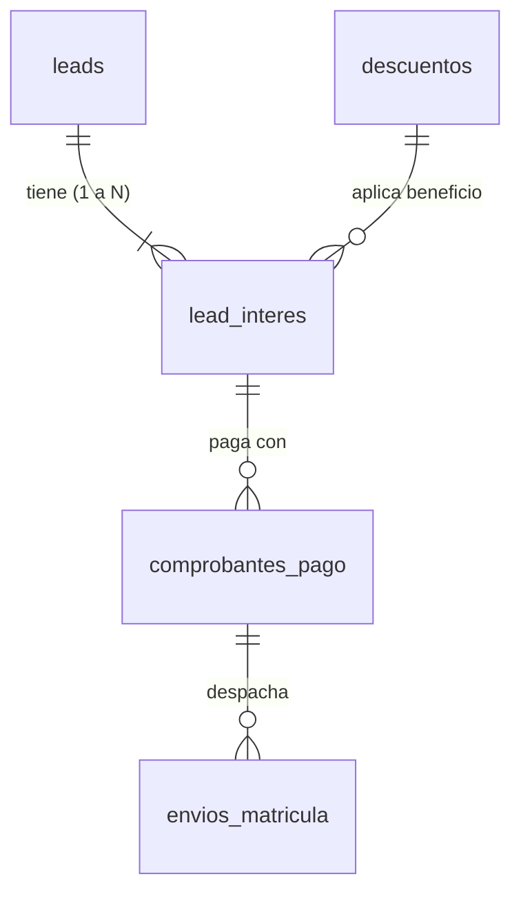
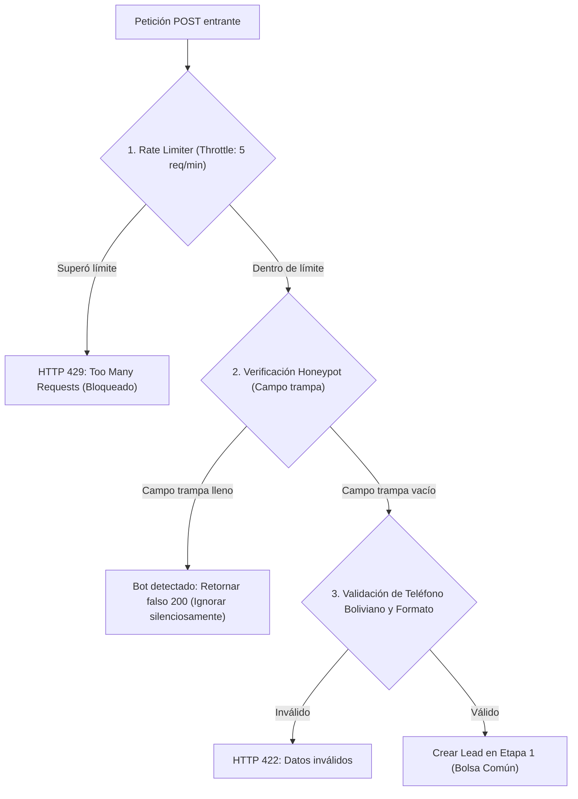

# 🏛️ PLAN MAESTRO DE IMPLEMENTACIÓN, ARQUITECTURA Y RUNBOOK DE DESPLIEGUE (ACTUALIZADO)
## CRM Educativo UNEXO | INF513 - Tecnología Web | Grupo 05 SC (2do Parcial)
**Docente:** Msc. Ing. Evans Balcázar Veizaga  
**Asesora de Negocio:** Ing. Miriam  
**Equipo:** Nataly Vanessa Martínez (Líder / Arquitectura & Deploy), Nicol Herbas (Kanban & Pipeline), Jael Sandoval (Importador & BI)

---

## 📑 ÍNDICE GENERAL

1. [Diagnóstico y Respuestas Estratégicas a las Dudas Críticas](#1-diagnóstico-y-respuestas-estratégicas-a-las-dudas-críticas)
   - 1.1. Conexión `.env` hacia el Desplegado de la API del Grupo 6 (Proyecto 2)
   - 1.2. Pasarela de Pagos: ¿Stripe o PagoFácil? Decisión Técnica Basada en el Docente
   - 1.3. Múltiples Intereses, Cobros Simultáneos y Reingreso de Ex-Alumnos (Modelo Relacional Detallado)
   - 1.4. ¿Dónde están los Endpoints en una SPA con Inertia vs API RESTful en Laravel?
   - 1.5. Seguridad y Blindaje del Formulario Público `/registro` (Antispam y Anti-DDoS)
   - 1.6. Corrección en la Matriz RBAC: Restricción del Vendedor en Bolsa Común
   - 1.7. Identidad Visual UNEXO, Espectro de Temas, Contador, Auditoría, Búsqueda y Sidebar (8 CU)
   - 1.8. Despliegue en Tecnoweb: Protocolo Operacional con SOLO FTP Habilitado
2. [Matriz de Tareas y Acciones Inmediatas por Integrante](#2-matriz-de-tareas-y-acciones-inmediatas-por-integrante)
3. [Cumplimiento de los 10 Requisitos Oficiales del Proyecto](#3-cumplimiento-de-los-10-requisitos-oficiales-del-proyecto)
4. [Runbook Definitivo de Despliegue en Tecnoweb con SOLO FTP](#4-runbook-definitivo-de-despliegue-en-tecnoweb-con-solo-ftp)
   - 4.1. El Reto: Desplegar Laravel + React sin Terminal SSH ni Cockpit
   - 4.2. Preparación del Build y Dependencias en Local
   - 4.3. Transferencia de Archivos vía FileZilla
   - 4.4. El Script Web Maestro: `deploy_runner.php` (Symlinks, Migraciones y Permisos)
   - 4.5. Protocolo de Defensa: Cómo Neutralizar las Trampas de Evans y Monitorear Logs

---

# 1. DIAGNÓSTICO Y RESPUESTAS ESTRATÉGICAS A LAS DUDAS CRÍTICAS

---

### 1.1. Conexión `.env` hacia el Desplegado de la API del Grupo 6 (Proyecto 2)

El CRM se integra con el backend del **Grupo 6 (Proyecto 2)** para dos propósitos:
1. **Lectura del Catálogo Oficial en Tiempo Real:** Cursos, diplomados, cohortes y grupos disponibles.
2. **Despacho de Matrículas:** Envío del payload del alumno para crear su usuario y registrar su inscripción cuando su pago es aprobado.

En `config/services.php` ya dejamos configuradas las claves correspondientes. Para conectar con el servidor desplegado del Grupo 6, en tu archivo `.env` debes configurar exactamente:

```ini
# =======================================================
# INTEGRACIÓN API EXTERNA (GRUPO 6 SC - PROYECTO 2)
# =======================================================
# 1. Endpoint para consultar el catálogo de programas y grupos:
CATALOG_API_URL=https://proyecto-l1e0.onrender.com/api/v1/catalogo

# 2. Endpoint para matricular al estudiante al aprobar su comprobante:
ENROLLMENT_API_URL=https://proyecto-l1e0.onrender.com/api/v1/matriculas
```

> 📌 **Nota de Producción:** Si el Grupo 6 despliega su sistema en el servidor de la materia (`https://www.tecnoweb.org.bo/inf513/grupo06sc/proyecto2/api/v1/...`), simplemente actualizas estas dos variables en el `.env` sin tener que recompilar ni tocar una sola línea de código PHP o React.

---

### 1.2. Pasarela de Pagos: ¿Stripe o PagoFácil? Decisión Técnica

#### 🔍 El Dilema:
- **PagoFácil:** El docente quería que se utilice PagoFácil, pero los estudiantes descubrieron una brecha de seguridad y la empresa no ha entregado las nuevas API keys a tiempo para este semestre.
- **Stripe:** En clase grabada, Evans dijo: *"Bueno, entonces lo podrían hacer con Stripe"*. Además, el grupo paralelo `inf513-proyecto2` ya implementó Stripe con éxito.

#### ⚖️ Comparativa Técnica:

| Criterio | PagoFácil MasterQR | Stripe (API Oficial) |
| :--- | :--- | :--- |
| **Moneda y Contexto** | Bolivianos (Bs) vía QR Simple. | Moneda configurable (`BOB` o `USD`), pagos con tarjeta. |
| **Disponibilidad de API Keys** | ❌ Retrasadas por brecha de seguridad. | ✅ Inmediatas y gratuitas (`pk_test_...` y `sk_test_...`). |
| **Entorno de Pruebas** | Requiere credenciales de comercio. | Tarjetas de prueba oficiales (`4242 4242 4242 4242`). |
| **Riesgo en la Defensa** | Alto si el servidor de PagoFácil cae. | Nulo si se implementa con arquitectura dual. |
| **Aprobación de Evans** | Sí, pero autorizó Stripe expresamente. | ✅ Autorizado por el docente y usado por otros grupos. |

#### 🎯 Decisión Definitiva: Arquitectura Híbrida (Simulada + Stripe)
Revisando `inf513-proyecto2`, implementaron un patrón muy elegante (`PasarelaPago` con `PasarelaSimulada` y `PasarelaStripe`):
1. **Modo Simulado por Defecto (`PAGOS_PASARELA=simulada`):**
   - No requiere conexión a internet ni claves externas.
   - En pantalla permite simular un cobro con tarjeta o QR y aprobar la transacción de inmediato con un clic.
   - **Es el seguro de vida del grupo para la defensa presencial.**
2. **Modo Stripe (`PAGOS_PASARELA=stripe`):**
   - Configurable con `STRIPE_KEY=pk_test_...` y `STRIPE_SECRET=sk_test_...`.
   - Utiliza Stripe Elements en React y valida la tarjeta de prueba de Stripe.
3. **Módulo de Vouchers Tradicionales:** Nuestro módulo de comprobantes bancarios (subida de recibo y revisión manual) se mantiene intacto como método de pago por transferencia bancaria.

---

### 1.3. Múltiples Intereses, Cobros Simultáneos y Reingreso de Ex-Alumnos (Modelo Relacional Detallado)

Para responder a la observación de la docente Miriam **sin romper las 17 tablas del primer parcial**, el modelo se extiende limpiamente con los siguientes ajustes:



#### A. Tablas y Atributos Afectados:

1. **Tabla `lead_interes` (Nuevas Columnas de Trazabilidad Comercial):**
   - `estado`: `VARCHAR(25) DEFAULT 'EN_SEGUIMIENTO'` (`EN_SEGUIMIENTO`, `EN_PAGO`, `MATRICULADO`, `DESCARTADO`).
   - `monto_pactado`: `NUMERIC(10,2) NULL` (El precio acordado para este diplomado o módulo específico).
   - `id_descuento`: `BIGINT NULL REFERENCES descuentos(id_descuento)` (Descuento aplicado a este curso en particular).
2. **Tabla `comprobantes_pago` (Asignación Específica del Pago):**
   - `id_interes`: `BIGINT NULL REFERENCES lead_interes(id_interes) ON DELETE SET NULL`.
   - **Impacto:** Cuando el prospecto o el asesor registra un pago, el sistema obliga a seleccionar:
     > *"¿A cuál de los intereses del prospecto corresponde este comprobante?"*  
     > `[ ] Diplomado en Inteligencia Artificial (Bs 1,800)`  
     > `[ ] Módulo Redes Sociales y Contenido (Bs 550)`
3. **Tabla `envios_matricula`:**
   - Queda vinculada tanto al comprobante como al interés específico, enviando al Grupo 6 el `cohorte_id` o `grupo_id` correspondiente a ese interés pagado.

#### B. Manejo de Intereses Simultáneos:
- Si María Laura está interesada en **IA** y en **Marketing**:
  - Paga el diplomado de **IA** ➔ El comprobante se asocia al interés de IA ➔ Ese interés pasa a `MATRICULADO` ➔ Se despacha la matrícula al Grupo 6.
  - El interés de **Marketing** se mantiene en `EN_SEGUIMIENTO`.
  - El lead se mantiene visible en el CRM para que el asesor continúe gestionando el interés pendiente.

#### C. Reingreso de Ex-Alumnos (Fidelidad y Descuentos Automáticos):
- Cuando una persona que ya concluyó un curso regresa 2 años después y se registra con su mismo `ci` o `correo`:
  - El sistema detecta: *"Prospecto identificado como Ex-Alumno de UNEXO"*.
  - Realiza un conteo histórico: `SELECT COUNT(*) FROM lead_interes WHERE id_lead = :id AND estado = 'MATRICULADO'`.
  - Si registra $\ge 1$ programa aprobado, el sistema sugiere automáticamente el **Descuento por Fidelidad / Ex-Alumno** configurado en la tabla `descuentos`.
  - No se duplica la identidad de la persona: se añade un nuevo interés a su ficha histórica conservando su trazabilidad de por vida.

---

### 1.4. ¿Dónde están los Endpoints en una SPA con Inertia vs API RESTful en Laravel?

#### 💡 La Explicación que Necesitabas:
En Laravel tradicional existen dos mundos de rutas:

1. **El Mundo Web con Inertia (`routes/web.php`):**
   - Aquí viven las rutas de la interfaz gráfica del CRM:
     ```php
     Route::get('/leads', [LeadController::class, 'index'])->name('leads.index');
     Route::post('/leads', [LeadController::class, 'store'])->name('leads.store');
     Route::get('/pipeline', [PipelineController::class, 'board'])->name('pipeline.board');
     ```
   - **¿Por qué funcionan como una SPA sin recargar la página?**
     - Cuando el usuario navega, Inertia hace peticiones HTTP asíncronas con el encabezado especial `X-Inertia: true`.
     - Cuando el controlador ejecuta:
       ```php
       return Inertia::render('Leads/Index', ['leads' => $leads]);
       ```
       Laravel **NO renderiza HTML**, sino que devuelve un payload **JSON puro**:
       ```json
       {
         "component": "Leads/Index",
         "props": { "leads": [...] },
         "url": "/leads",
         "version": "..."
       }
       ```
     - React intercepta ese JSON y reemplaza el contenido en el DOM al instante. **Por eso es una SPA auténtica sobre HTTP.**

2. **El Mundo de la API RESTful Pura (`routes/api.php`):**
   - Aquí viven los endpoints independientes de la interfaz web, pensados para clientes externos (Postman, aplicaciones móviles, webhooks bancarios y el Grupo 6):
     ```php
     Route::post('/v1/leads/pre-registro', [PublicLeadApiController::class, 'preRegistro']);
     Route::get('/v1/catalogo', [CatalogApiController::class, 'index']);
     Route::post('/v1/pagos/stripe/webhook', [StripeWebhookController::class, 'handle']);
     ```
   - No usan cookies de sesión ni protección CSRF web; responden siempre con `response()->json([...])`.
   - **Con esto cumples al 100% con la exigencia de arquitectura RESTful evaluada por Evans.**

---

### 1.5. Seguridad y Blindaje del Formulario Público `/registro` (Antispam y Anti-DDoS)

Dado que `/registro` (o `/postulacion`) será un formulario accesible por cualquier persona desde redes sociales, debemos evitar que ataques maliciosos de 200 peticiones por segundo tumben el servidor o llenen la base de datos de basura:



#### Medidas de Protección Implementadas:
1. **Rate Limiting Estricto en Laravel (`throttle:5,1`):**
   - En la ruta:
     ```php
     Route::post('/registro', [PublicRegistrationController::class, 'store'])
         ->middleware('throttle:5,1');
     ```
   - Cada IP solo puede enviar un máximo de 5 solicitudes por minuto. La solicitud número 6 es rechazada en 1 milisegundo con código `HTTP 429 Too Many Requests` antes de llegar a la base de datos.
2. **Técnica del Honeypot (Campo Trampa para Bots):**
   - En el formulario React agregamos un campo oculto invisible para humanos:
     ```jsx
     <input 
       type="text" 
       name="website_url_trap" 
       style={{ display: 'none' }} 
       tabIndex="-1" 
       autoComplete="off" 
       value={data.website_url_trap} 
       onChange={e => setData('website_url_trap', e.target.value)} 
     />
     ```
   - Los bots rellenan automáticamente todos los inputs de un formulario. Si el backend detecta que `website_url_trap` contiene texto, descarta la petición de inmediato simulando un éxito para despistar al atacante.
3. **Validación de Teléfono Boliviano:**
   - 8 dígitos obligatorios iniciando exclusivamente con `6` o `7` (celulares) o 7 dígitos con `3`, `2` o `4` (fijos).

---

### 1.6. Corrección en la Matriz RBAC: Restricción del Vendedor en Bolsa Común

Atendiendo a tu indicación exacta:
> *"El vendedor no puede tomar leads manuales, solo se le puede asignar el admin, puede ver la bolsa común, pero no tomarlos, eso lo hace el admin con asignación manual o round robin"*

#### Matriz Oficial de Permisos Actualizada:

| Acción Comercial | Administrador | Coordinador | Vendedor |
| :--- | :---: | :---: | :---: |
| **Ver Bolsa Común (Etapa 1)** | ✅ Sí | ❌ No | ✅ **Solo Lectura** (ve la cola pero sin botones de acción) |
| **Tomar Leads Manualmente** | ✅ Sí | ❌ No | ❌ **BLOQUEADO** (no puede autotomarse prospectos) |
| **Ejecutar Round-Robin** | ✅ Sí | ❌ No | ❌ No |
| **Atender en Pipeline Kanban** | ✅ Ve todos | ✅ Solo sus versiones | ✅ **Solo "Mis Leads" asignados** |
| **Reasignar Vendedor (Transferencia)**| ✅ Sí (con motivo) | ✅ Sí (de sus versiones) | ❌ No permitido |
| **Subir Comprobante de Pago** | ✅ Sí | ❌ No | ✅ Sí (para sus prospectos asignados) |
| **Aprobar / Rechazar Pago** | ✅ Sí (Tesorería) | ❌ Solo consulta | ❌ No permitido |
| **Despacho a Proyecto 2 (Matrícula)** | ✅ Sí | ❌ Solo consulta | ❌ No permitido |

---

### 1.7. Identidad Visual UNEXO, Espectro de Temas, Contador, Auditoría, Búsqueda y Sidebar

#### A. Identidad Institucional UNEXO (Basada en `unexo1.jpeg` y `unexo2.jpeg`):
El logotipo oficial de la **Unidad de Emprendimiento y Tecnología Avanzada (UNEXO)** define la siguiente tríada cromática oficial:
- **Azul Noche UNEXO (Primario / Estructura):** `#0a2540` / `#002855` (representa tecnología, academia y formalidad institucional).
- **Cyan / Teal Tecnológico (Secundario / Innovación):** `#00b4d8` / `#00a8b5` (el color de la letra "O" y nodos del isotipo).
- **Coral / Rojo Acento (Destacados y Alertas):** `#e63946` / `#e5383b` (los nodos de conexión y enlaces de énfasis).
- **Fondo General:** Blanco puro `#ffffff` y gris perla claro `#f8fafc`.

#### B. Espectro de los 3 Temas Dinámicos (Sin romper la paleta UNEXO):
1. **Tema Adultos (Formal / Institucional):**
   - Tipografía sans-serif sobria, estructurada.
   - Predominio de Azul Noche `#0a2540` en encabezados y barras.
   - **Bordes rectangulares estrictos (`border-radius: 0px`).**
   - Diseño compacto de alta densidad para máxima productividad analítica.
2. **Tema Jóvenes (Moderno / SaaS Tech):**
   - Tipografía moderna con realces en Cyan/Teal `#00b4d8`.
   - Micro-bordes suaves (`border-radius: 4px`).
   - Fondos con gradientes sutiles y tarjetas con sombras flotantes.
3. **Tema Niños (Amigable / Lúdico):**
   - Fondo cálido y acogedor con un tinte amarillento crema muy suave (`#fdfbf7` / `#fefae0`).
   - El Azul UNEXO se mantiene en los elementos clave para no perder la identidad, con botones e íconos en colores más vivos.
   - **Bordes muy redondeados (`border-radius: 16px` a `24px`).**
   - Tipografía ligeramente más grande con espaciado amplio.
4. **Modo Día / Noche:** Conmutación automática o manual según el horario del cliente (06:00 a 18:59 = día; 19:00 a 05:59 = noche).

#### C. Contador de Visitas Persistente (Requisito 7 de Evans):
- **¿Es otra tabla? SÍ.** Se crea la tabla dedicada `visitas`:
  ```sql
  CREATE TABLE public.visitas (
      id BIGSERIAL PRIMARY KEY,
      pagina VARCHAR(120) UNIQUE NOT NULL,
      contador BIGINT DEFAULT 0,
      actualizado_en TIMESTAMP
  );
  ```
- El middleware `ContadorVisitas` realiza un `UPSERT` en PostgreSQL incrementando el contador cada vez que se carga una vista.
- Se muestra obligatoriamente en el **Footer** de cada vista:
  > *"Página visitada 1,245 veces | INF513 - Tecnología Web - Grupo 05 SC"*

#### D. Bitácora de Negocio vs Bitácora de Auditoría del Sistema:
- **Bitácora de Negocio (`bitacora`):** Registra el ciclo de vida del prospecto (`id_lead`, cambios de etapa, notas comerciales, usuario que intervino).
- **Bitácora de Auditoría del Sistema (`auditorias_sistema` o `bitacora_accesos`):** Registra los eventos de seguridad y tráfico exigidos por Evans:
  - Inicios de sesión exitosos y fallidos.
  - Dirección IP del cliente (`$request->ip()`).
  - Navegador y agente de usuario (`user_agent`).
  - Ruta accedida y método HTTP.
- En la interfaz del Administrador, ambas bitácoras se consultan desde pestañas separadas para no mezclar la auditoría técnica con el seguimiento comercial.

#### E. Búsqueda Global en el Header (Requisito 9):
Input predictivo en la barra superior que permite buscar dos tipos de entidades:
1. **Navegación Rápida a Módulos:** Si el usuario escribe *"Pipeline"*, *"Descuentos"*, *"Usuarios"* o *"Reportes"*, el buscador lo sugiere y al presionar Enter navega a esa sección.
2. **Búsqueda de Prospectos:** Permite escribir el nombre, CI o teléfono de un lead para abrir directamente su ficha.

#### F. Reorganización del Sidebar en los 8 Casos de Uso (Menú Acordeón Conciso):
Organizado en grupos colapsables con nombres cortos de 2 a 4 palabras:

```text
📁 CU1. Usuarios y Roles
   ├── Gestión de Usuarios
   └── Permisos de Sistema
📁 CU2. Captación y Oferta
   ├── Registrar Prospecto
   ├── Catálogo Académico
   └── Canales de Origen
📁 CU3. Asignación Comercial
   ├── Bolsa Común (Etapa 1)
   └── Reparto Round-Robin
📁 CU4. Embudo Kanban
   ├── Tablero Pipeline
   └── Mis Prospectos
📁 CU5. Motivos de Pérdida
   └── Catálogo de Bajas
📁 CU6. Pagos y Matrícula
   ├── Revisión de Pagos
   └── Pasarela de Cobro
📁 CU7. Bitácora y Agenda
   ├── Timeline de Eventos
   └── Recordatorios
📁 CU8. Analítica y BI
   ├── Embudo General
   └── Métricas Coordinador
```

---

### 1.8. Despliegue en Tecnoweb: Protocolo Operacional con SOLO FTP Habilitado

#### 🚨 La Realidad Confirmada por Evans en Telegram:
> **Róger Roca:** *"Cuál es la contraseña para ingresar por SSH? En Cockpit tengo error de permiso denegado..."*  
> **Evans Balcázar:** *"Solo está habilitado FTP"*

**¿Qué implica esto técnicamente?**
- **NO hay acceso por terminal SSH.**
- **Cockpit (puerto 9090) está cerrado o bloqueado.**
- **NO puedes correr comandos de terminal en el servidor** (no hay `git clone`, no hay `composer install`, no hay `npm run build`, no hay `ln -s`, no hay `php artisan migrate`).

**¿Cómo se despliega entonces un proyecto Laravel + React bajo estas condiciones?**
A continuación te presento la estrategia maestra que utilizan los grupos expertos para desplegar y correr migraciones usando únicamente FTP.

---

# 4. RUNBOOK DEFINITIVO DE DESPLIEGUE EN TECNOWEB CON SOLO FTP

---

### 4.1. El Reto: Desplegar sin Terminal

Cuando solo tienes FTP (FileZilla), toda la preparación del software debe ocurrir en tu máquina local antes de transferir los archivos, y las operaciones del servidor (symlinks y migraciones de PostgreSQL) se ejecutan mediante un **Script PHP Runner** disparado desde el navegador.

---

### 4.2. Paso 1: Preparación del Build y Dependencias en Local

En tu máquina de desarrollo (donde sí tienes consola bash, composer y npm):

```bash
cd /home/nataly/Projects/crm-educativo/crm

# 1. Configurar vite.config.js para la subcarpeta de producción
# El base debe ser: '/inf513/grupo05sc/proyecto2/build/'

# 2. Compilar el frontend en modo producción
npm run build

# 3. Instalar las dependencias de producción de PHP (optimizadas y sin herramientas dev)
composer install --optimize-autoloader --no-dev
```

---

### 4.3. Paso 2: Transferencia vía FileZilla

1. **Abrir FileZilla:**
   - **Host:** `mail.tecnoweb.org.bo` (o `www.tecnoweb.org.bo`)
   - **Usuario:** `grupo05sc`
   - **Contraseña:** `grup005grup005*`
   - **Puerto:** `21`
2. **Estructura en el Servidor Remoto (`/home/grupo05sc`):**
   - Crear el directorio `apps` dentro de `/home/grupo05sc`.
   - Subir la carpeta completa de tu proyecto local dentro de `/home/grupo05sc/apps/proyecto2`.
   - Subir el archivo de protección `/home/grupo05sc/apps/.htaccess` con el contenido:
     ```apache
     Require all denied
     ```
     *(Esto impide que cualquier persona descargue el `.env` o código fuente).*
3. **El archivo `.env` de producción en `/home/grupo05sc/apps/proyecto2/.env`:**
   ```ini
   APP_NAME="CRM Educativo UNEXO"
   APP_ENV=production
   APP_DEBUG=false
   APP_URL=https://www.tecnoweb.org.bo/inf513/grupo05sc/proyecto2
   ASSET_URL=https://www.tecnoweb.org.bo/inf513/grupo05sc/proyecto2

   # PostgreSQL local en el VPS
   DB_CONNECTION=pgsql
   DB_HOST=127.0.0.1
   DB_PORT=5432
   DB_DATABASE=db_grupo05sc
   DB_USERNAME=grupo05sc
   DB_PASSWORD=grup005grup005*

   SESSION_DRIVER=file
   CACHE_STORE=file
   SESSION_PATH=/inf513/grupo05sc/proyecto2

   # API Externa Grupo 6
   CATALOG_API_URL=https://proyecto-l1e0.onrender.com/api/v1/catalogo
   ENROLLMENT_API_URL=https://proyecto-l1e0.onrender.com/api/v1/matriculas

   # Pasarela de Pagos (Modo Simulado activo para defensa)
   PAGOS_PASARELA=simulada
   ```

---

### 4.4. Paso 3: El Script Web Maestro (`deploy_runner.php`)

Como no tienes consola SSH para hacer `ln -s` ni correr `php artisan migrate`, creamos un archivo PHP en la raíz accesible por Apache:  
`/home/grupo05sc/deploy_runner.php`

```php
<?php
// /home/grupo05sc/deploy_runner.php
// Clave de seguridad para que solo el grupo pueda ejecutarlo:
if (($_GET['key'] ?? '') !== 'unexo2026') {
    die("Acceso denegado. Se requiere clave de autorizacion.");
}

header('Content-Type: text/plain; charset=utf-8');
echo "=== INICIANDO RUNNER DE DESPLIEGUE INF513 - GRUPO 05 ===\n\n";

$baseApp = __DIR__ . '/apps/proyecto2';
$publicSymlink = __DIR__ . '/proyecto2';

// 1. Crear el enlace simbólico hacia public/ si no existe
if (!file_exists($publicSymlink)) {
    if (symlink($baseApp . '/public', $publicSymlink)) {
        echo "✅ Symlink creado: ~/proyecto2 -> ~/apps/proyecto2/public\n";
    } else {
        echo "❌ Error al crear el symlink. Intentando creacion de directorio puente...\n";
    }
} else {
    echo "ℹ️ El symlink ~/proyecto2 ya existe.\n";
}

// 2. Ajustar permisos de storage y .env
@chmod($baseApp . '/.env', 0644);
@chmod($baseApp . '/storage', 0777);
echo "✅ Permisos aplicados (.env: 644, storage: 777)\n";

// 3. Bootstrapear Laravel para ejecutar comandos Artisan
require $baseApp . '/vendor/autoload.php';
$app = require_once $baseApp . '/bootstrap/app.php';
$kernel = $app->make(Illuminate\Contracts\Console\Kernel::class);
$kernel->bootstrap();

// 4. Ejecutar migraciones en PostgreSQL
try {
    echo "\n--- EJECUTANDO MIGRACIONES DE BASE DE DATOS ---\n";
    Illuminate\Support\Facades\Artisan::call('migrate --force');
    echo Illuminate\Support\Facades\Artisan::output();
    echo "✅ Migraciones ejecutadas exitosamente.\n";
} catch (\Throwable $e) {
    echo "❌ Error en migraciones: " . $e->getMessage() . "\n";
}

// 5. Limpiar y recrear caché de configuración
try {
    Illuminate\Support\Facades\Artisan::call('optimize:clear');
    Illuminate\Support\Facades\Artisan::call('config:cache');
    Illuminate\Support\Facades\Artisan::call('route:cache');
    Illuminate\Support\Facades\Artisan::call('view:cache');
    echo "✅ Caches de produccion generados exitosamente.\n";
} catch (\Throwable $e) {
    echo "⚠️ Advertencia en cache: " . $e->getMessage() . "\n";
}

echo "\n=== DESPLIEGUE FINALIZADO EXITOSAMENTE ===\n";
echo "Accede a la aplicacion en: https://www.tecnoweb.org.bo/inf513/grupo05sc/proyecto2/\n";
```

#### ¿Cómo se ejecuta?
Simplemente abres tu navegador y visitas:  
`https://www.tecnoweb.org.bo/inf513/grupo05sc/deploy_runner.php?key=unexo2026`

Verás en pantalla en tiempo real:
- La creación del symlink.
- La ejecución de todas las migraciones de PostgreSQL.
- La generación de las cachés de Laravel.

*(Una vez confirmado el funcionamiento, eliminas el archivo por FTP o le cambias la clave).*

---

### 4.5. Protocolo de Defensa: Cómo Neutralizar las Trampas de Evans y Monitorear Logs

| Trampa de Evans durante la Defensa | ¿Qué causa el error? | ¿Cómo lo solucionas inmediatamente? |
| :--- | :--- | :--- |
| **Cambia la clave en `.env`** | Error "Connection refused" en BD | Subir el `.env` corregido por FileZilla en 2 segundos. |
| **Borra el symlink `~/proyecto2`** | Error 404 al cargar la URL | Abrir `deploy_runner.php?key=unexo2026` en el navegador para recrearlo. |
| **Caché corrupta** | Métodos HTTP no permitidos | Abrir el runner para ejecutar `optimize:clear`. |
| **Intento de ver `.env` por navegador** | Escribe `https://.../apps/proyecto2/.env` | Verifica que responda **403 Forbidden** por el `.htaccess`. |

---

# 5. RESUMEN DE ENTREGA Y ARCHIVOS ASOCIADOS

1. **[PLAN_MAESTRO_IMPLEMENTACION_Y_DEPLOY_2P.md](file:///home/nataly/Projects/crm-educativo/PLAN_MAESTRO_IMPLEMENTACION_Y_DEPLOY_2P.md):** Esta guía integral con toda la arquitectura, decisiones y comandos.
2. **[TareasPendientes.md](file:///home/nataly/Projects/crm-educativo/TareasPendientes.md):** El checklist ejecutivo independiente para que Nicol, Jael y Nataly ejecuten sus tareas sin confusiones.
